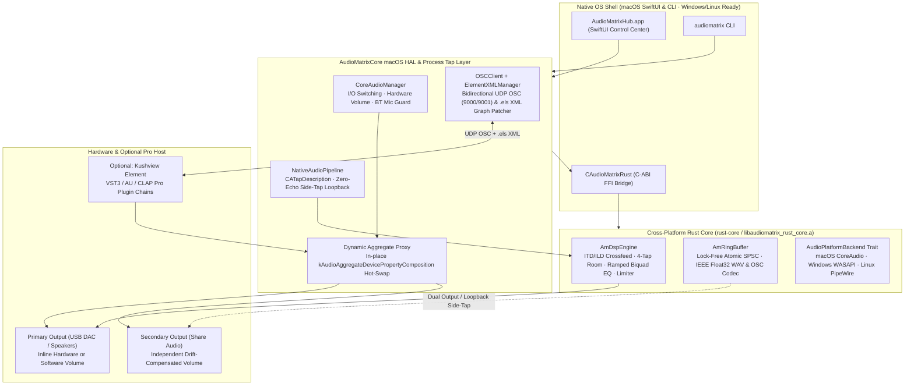

<div align="center">

# AudioMatrixHub

**Hybrid Rust C-ABI Audio Core + Native macOS SwiftUI Control Center — decoupled CoreAudio I/O routing, real-time studio speaker simulation, output-stage per-app mixer, zero-echo loopback virtual mic, and optional VST3/AU plugin chaining.**

[English](README.md) · [简体中文](README.zh-CN.md)

[](https://www.apple.com/macos/)
[](#windows--linux-desktop-gui-rust-eframe)
[](#windows--linux-desktop-gui-rust-eframe)
[](rust-core/)
[](https://swift.org/)
[](LICENSE)

</div>

---

## Why AudioMatrixHub?

macOS separates neither hardware input/output workflows cleanly nor offers native per-application routing, dual-headphone sync, or spatial monitor simulation without expensive commercial suites:

- **Decoupled Input & Output + Bluetooth Mic Hijack Guard**: Switch physical DACs, speakers, and Bluetooth headphones in one click from the menu bar, while automatically blocking macOS from silently switching your microphone to low-bandwidth Bluetooth HFP/SCO profiles when AirPods connect.
- **Hybrid Rust Core (`libaudiomatrix_rust_core.a`) + Native OS Shell Architecture**:
  - **Portable Zero-Allocation Rust C-ABI Engine (`rust-core/`)**: Hosts the lock-free `Acquire`/`Release` SPSC atomic ring buffer (`AmRingBuffer`), real-time ITD/ILD speaker spatializer, 4-tap early reflections, click-free ramped biquad Tone EQ & limiter (`AmDspEngine`), IEEE Float32 WAV encoder, OSC 1.0 slugify/codec, and the cross-platform `AudioPlatformBackend` trait (`macos-coreaudio`, `windows-wasapi`, `linux-pipewire`). Compiled & tested on macOS, Linux, and Windows in CI.
  - **Lightweight Native OS Shell (`Swift` / `SwiftUI`)**: Keeps UI crisp with native `MenuBarExtra` and talks directly to macOS CoreAudio HAL / `CATapDescription` without Electron or webview bloat, making future Windows/Linux UI shells effortless to swap atop the shared Rust core.
- **Native CoreAudio Process Tap App Mixer & Per-App Routing (Non-Destructive + Reset to Default)**: Built directly on macOS 14.2+ `CATapDescription` & `AudioHardwareCreateProcessTap` with a lock-free SPSC ring buffer (`LockFreeAudioRingBuffer`)—adjust per-app volume (`0%–200%`), mute, and route individual apps at the **output stage** without altering the app's own internal volume, with a single-click **`Reset to Default`**.
- **Loopback & Internal Audio WAV Recorder (Zero-Echo Side-Tap Mixer)**: Non-destructively capture live system audio with an independent multi-channel mixer (Microphone gain `0%–250%`, System Audio master gain `0%–200%`, plus per-app inclusion toggles and independent Loopback gain sliders—completely independent of what you hear in your headphones, with zero headphone echo) using the built-in zero-driver **`AudioMatrix Virtual Mic`** (`CATapDescription` public aggregate device — requires no third-party HAL driver installation) or external virtual buses (`BlackHole 2ch` / `MOTIV Mix Virtual`) for OBS/Zoom/DAWs, or record internal audio directly to a 48kHz 32-bit Float stereo `.wav` file in `~/Downloads`.
- **Share Audio (Dual Output) with Independent Volume Sliders**: Drive two headphones simultaneously (e.g., USB DAC + AirPods Max) using drift-compensated CoreAudio aggregate devices or dual lock-free ring buffers with independent volume sliders for both devices.
- **Optional Pro VST3 / AU Host Bridge (`<20ms` Hot-Swap Proxy)**: Power users who want commercial VST3/AU chains (Waves NX, SoundID Reference, FabFilter) can bridge to [Kushview Element](https://github.com/kushview/element) over bidirectional UDP OSC (`9000` / `9001`) and XML graph patching—backed by a **Dynamic Aggregate Proxy** (`com.audiomatrix.proxy.output`) that hot-swaps target headphones in `<20ms` without restarting the host.

---

## System Architecture



---

## Built-in DSP Mathematical Model (`rust-core/src/dsp.rs`)

All real-time DSP stages execute inside [`rust-core/src/dsp.rs`](rust-core/src/dsp.rs) (`AmDspEngine`) and bridge into Swift via [`CAudioMatrixRust`](Sources/CAudioMatrixRust/include/audiomatrix_rust_core.h) with **zero heap allocations** inside real-time audio `IOProc` callbacks:

1. **Binaural Speaker Crossfeed (ITD + ILD Head-Shadow Model)**:
   - Contralateral ear delay line implements an Interaural Time Difference of $\Delta t \approx 0.29\text{ ms}$ ($\approx 14$ samples at $48\text{ kHz}$).
   - A 1st-order head-shadowing low-pass filter ($f_c = 1400\text{ Hz}$) models high-frequency diffraction attenuation around the head, paired with a $+1.2\text{ dB}$ low-shelf compensation below $300\text{ Hz}$ to preserve low-end body.
2. **Early Studio Room Reflections (4-Tap Haas Network)**:
   - Four alternating cross-panned delay taps at $7.3\text{ ms}$, $11.9\text{ ms}$, $17.1\text{ ms}$, and $23.4\text{ ms}$ pass through a $3.5\text{ kHz}$ air-absorption low-pass filter to create natural nearfield monitor depth without muddy reverb tails.
3. **Click-Free Ramped Biquad EQ**:
   - Direct Form II Transposed Low-Shelf ($110\text{ Hz}$), Mid Bell ($2.5\text{ kHz}$), and High-Shelf ($7.0\text{ kHz}$) filters recompute coefficients in $\le 0.05\text{ dB}$ micro-steps every $64$ frames while scalar parameters smooth via a 1-pole exponential envelope ($\alpha = 0.995$), guaranteeing zero zipper noise or pops while dragging sliders.
4. **Safe Headroom Soft-Knee Limiter**:
   - Fast-attack ($0.5\text{ ms}$) / smooth-release ($80\text{ ms}$) peak envelope follower combined with $\tanh$ soft-knee saturation below $-0.3\text{ dBFS}$ ($\le 1.0$) and non-finite sample sanitization.

---

## Installation & Quick Start

### Requirements
- **macOS 14.0+** (native CoreAudio Process Tap per-app routing requires **macOS 14.2+**)
- **Rust 1.75+ (`cargo` / `rustc`)** & **Swift 5.10+** (Xcode Command Line Tools are sufficient; full Xcode is not required)
- **Windows / Linux (`rust-core/` only)**: Compiles and passes `cargo test` natively on Windows & Linux CI targets.

### Build macOS (`AudioMatrixHub.app` + `audiomatrix`)

```bash
git clone https://github.com/Joooooooooshua/AudioMatrixHub.git
cd AudioMatrixHub

# 1. Test & build the cross-platform Rust C-ABI Core
cargo test --release --manifest-path rust-core/Cargo.toml
cargo build --release --manifest-path rust-core/Cargo.toml

# 2. Build macOS SwiftUI & CLI release binaries linked against libaudiomatrix_rust_core.a
swift build -c release

# 3. Package /Applications/AudioMatrixHub.app and link `audiomatrix` CLI
./scripts/bundle_app.sh

# Optional: also install BlackHole 2ch (needed only for external Kushview Element VST3/AU hosting)
./scripts/bundle_app.sh --install-deps
# Or via CLI:
audiomatrix install-deps

# Run built-in automated test suite (6 suites)
audiomatrix self-test

# Launch Menu Bar App
open -a /Applications/AudioMatrixHub.app
```

### Windows & Linux Desktop GUI (Rust `eframe`)

```bash
# Build native dark-mode desktop Control Center (`audiomatrix-desktop`) + CLI (`audiomatrix-pc`)
cargo build --release --manifest-path rust-desktop/Cargo.toml

# Run 6-suite cross-platform audio driver & DSP verification
./rust-desktop/target/release/audiomatrix-pc self-test

# Launch the native Rust Control Center window (WASAPI on Windows / PipeWire on Linux)
./rust-desktop/target/release/audiomatrix-desktop
```

---

## CLI Usage (`audiomatrix`)

```bash
# Inspect active inputs, outputs, hardware/software volumes, and plugin slots
audiomatrix status

# Decoupled I/O switching
audiomatrix input "Shure MV7i"
audiomatrix output "Fosi Audio SK02"
audiomatrix volume "Fosi Audio SK02" 75

# Orthogonal Built-in Speaker Simulation & Tone EQ (stackable independently)
audiomatrix speaker studio     # off | nearfield | studio | stage
audiomatrix tone vshape        # off | warm | clear | bass | vshape

# Drift-compensated Dual Output (Share Audio)
audiomatrix listen-together on "Fosi Audio SK02" "AirPods Max"
audiomatrix listen-together off

# Native output-stage per-app mixer, routing & reset
audiomatrix route-app com.apple.Music "MacBook Pro Speakers"
audiomatrix app-volume com.apple.Music 60
audiomatrix reset-apps

# Record internal system audio to 48kHz Float32 WAV
audiomatrix record 10 ~/Downloads/internal_capture.wav

# Optional external Element VST3/AU plugin slots & live OSC control
audiomatrix plugins FabFilter
audiomatrix slot-add output "SoundID Reference"
audiomatrix bypass soundid-reference on
```

---

## Project Layout

```text
AudioMatrixHub/
├── Package.swift
├── .github/workflows/ci.yml              # Multi-OS Rust CI (macOS/Linux/Win) + macOS Swift FFI CI
├── scripts/bundle_app.sh                 # Builds Rust Core + Swift binaries + ad-hoc .app bundler
├── rust-core/
│   ├── Cargo.toml                        # Zero-dependency cross-platform C-ABI & driver crate
│   └── src/
│       ├── lib.rs                        # Public C-ABI & Rust exports
│       ├── dsp.rs                        # AmDspEngine (ITD/ILD, Haas room, ramped EQ, limiter)
│       ├── ring_buffer.rs                # Lock-free atomic SPSC stereo audio ring buffer
│       ├── wav.rs                        # 48kHz IEEE Float32 RIFF/WAVE encoder
│       ├── osc.rs                        # OSC 1.0 slugify & binary encoder/decoder
│       └── backend.rs                    # Cross-platform WASAPI / PipeWire / CoreAudio drivers
├── rust-desktop/
│   ├── Cargo.toml                        # Cross-platform Windows/Linux/macOS GUI & CLI crate
│   └── src/
│       ├── main_gui.rs                   # Native eframe/egui dark Control Center (`audiomatrix-desktop`)
│       └── main_cli.rs                   # Cross-platform CLI & 6-suite runner (`audiomatrix-pc`)
└── Sources/
    ├── CAudioMatrixRust/                 # Clang module & C-ABI FFI header bridging libaudiomatrix_rust_core.a
    ├── AudioMatrixCore/
    │   ├── Models.swift                  # Portable configs, presets, & device models
    │   ├── BuiltInDSPEngine.swift        # Swift thread-safe FFI facade for Rust AmDspEngine
    │   ├── CoreAudioManager.swift        # HAL I/O, volume, BT guard & Dynamic Aggregate Proxy
    │   ├── NativeAudioPipeline.swift     # Rust SPSC ring relay & CATapDescription per-app/loopback tap
    │   ├── ElementXMLManager.swift       # .els graph parser & stereo arc auto-wiring
    │   ├── OSCClient.swift               # Bidirectional UDP OSC 1.0 encoder/decoder
    │   └── FineTuneBridge.swift          # App discovery & optional Element/FineTune bridge
    ├── AudioMatrixHub/
    │   ├── AudioMatrixHubApp.swift       # Native SwiftUI MenuBarExtra Control Center UI
    │   └── AudioMatrixViewModel.swift    # Reactive audio state & DSP coordinator
    └── AudioMatrixCLI/
        └── main.swift                    # CLI interface & 6-suite FFI self-test runner
```

## License

Released under the [MIT License](LICENSE).
