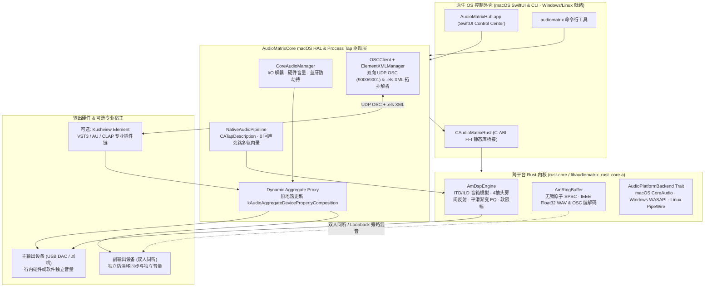

<div align="center">

# AudioMatrixHub

**跨平台 Rust C-ABI 音频内核 + 原生 macOS SwiftUI 控制中心：支持输入输出解耦、蓝牙防劫持、内置零爆音音箱声场模拟、CoreAudio 分软件路由、0 回声旁路多轨内录与可选 VST3/AU 宿主桥接。**

[English](README.md) · [简体中文](README.zh-CN.md)

[](https://www.apple.com/macos/)
[](#windows--linux-桌面端编译与运行-rust-eframe)
[](#windows--linux-桌面端编译与运行-rust-eframe)
[](rust-core/)
[](https://swift.org/)
[](LICENSE)

</div>

---

## 核心特性与设计哲学

AudioMatrixHub 旨在将商业音频工具的核心优点融为一体，并遵循**「开箱即用启蒙 $\rightarrow$ 原生生态 $\rightarrow$ 专业 VST3 扩展」**的三层递进设计：

0. **Rust 跨平台底层内核 + 原生 OS 外壳混合架构 (`rust-core` C-ABI + `SwiftUI`)**：
   - **可移植零 GC Rust C-ABI 核心 (`rust-core/` · `libaudiomatrix_rust_core.a`)**：将无锁 `Acquire`/`Release` 原子环形缓冲区 (`AmRingBuffer`)、实时双耳 DSP 与平滑渐变 EQ (`AmDspEngine`)、IEEE Float32 WAV 编码、OSC 编解码以及跨平台音频后端抽象 Trait（`macOS CoreAudio` / `Windows WASAPI` / `Linux PipeWire`）下沉至纯 Rust，并在 CI 中原生通过 macOS / Linux / Windows 三端编译测试。
   - **轻量原生 UI 与系统驱动层 (`Swift` / `SwiftUI`)**：保留系统原生 `MenuBarExtra` 顺滑交互，零 Electron/WebView 冗余开销，同时让未来移植至 Windows/Linux 桌面 UI 外壳仅需对接同一份 Rust Core 静态库。
1. **输入/输出彻底解耦 + 蓝牙麦克风防劫持 (`BT Mic Guard`)**：
   - 在顶部菜单栏一键独立切换物理耳机（USB DAC、AirPods Max、内置扬声器等）与麦克风。
   - 监听 CoreAudio HAL 硬件变化事件：当蓝牙耳机连接导致系统偷偷切换通话输入时，自动在 50ms 内锁回你的专业麦克风（保留 48kHz 高音质 A2DP 模式），同时绝不拦截你手动点击切换任意麦克风。
2. **开箱即用、正交可叠加的内置声学 DSP 引擎（零第三方插件/驱动依赖）**：
   - 将**「空间音响模拟」**与**「普适音色 EQ」**拆分为两个彼此独立、可自由叠加的串联模块，避免无耳机测量数据时强行套用"哈曼/平直"绝对曲线的伪科学问题：
     - **Speaker 音响模拟（`Off` · `Nearfield` · `Studio` · `Stage`）**：基于 ITD/ILD 双耳时间差与早期反射的近场/录音棚/厅堂声场模拟。
     - **Tone EQ 音色风格（`Off` · `Warm` · `Clear` · `Bass+` · `V-Shape`）**：面向全耳机的相对音乐音色塑形（如温暖醇厚、通透人声、低音增强、舞曲流行两头翘），可与任意音响模拟同时开启。
     - 点击 **`Tune`** 展开微调子菜单，可实时无爆音调节 **Speaker Crossfeed**、**Room Ambience**、**Bass / Mid / Treble** 与 **Safe Headroom Limiter（防削波软限幅器）**。
3. **双人同听 (`Share Audio`) + 独立双音量滑块**：
   - 主面板当前选中的输出设备自带内嵌音量滑块；开启 `Share Audio (Dual Output)` 后可任选第二副耳机同步听歌，并在主面板为两副耳机独立调节音量（支持硬件标量音量及 SPSC 环形缓冲软件增益）。
4. **原生 `CoreAudio Process Tap` 输出侧软件调音台（带 `Reset to Default`）**：
   - 基于 macOS 14.2+ 原生 `CATapDescription` 与 `AudioHardwareCreateProcessTap` API + 无锁环形缓冲区（`LockFreeAudioRingBuffer`）：在**最终输出侧**为每个运行软件独立调节音量（`0%–200%`）、静音或切换输出耳机，绝不篡改软件底层自身音量；一键点击 **`Reset to Default`** 即可瞬间撤销所有软件调音台与路由设置。
5. **Loopback 实时内录与内置 WAV 录音机（0 回声旁路多轨混音 · 零驱动内置虚拟麦）**：
   - 基于 macOS 14.2+ 公开聚合设备 + `CATapDescription`，自带零第三方驱动的 **`AudioMatrix Virtual Mic (Built-in)`** 虚拟输入跳线，无需安装 BlackHole 即可直接在微信 / Zoom / OBS / QuickTime 中使用；同时也兼容 `BlackHole 2ch` / `MOTIV Mix Virtual` 总线（提供一键安装 `BlackHole 2ch` 按钮），并内置一键录制 `48kHz 32-bit Float` 立体声 `.wav` 文件到下载目录。
   - **完全独立于耳机监听的多轨旁路混音器**：采用纯旁路采集，耳机端保持 0 回声监听；可自由勾选并独立调节进入内录/虚拟麦的 **物理麦克风增益（`0%–250%`）**、**系统总音量（`0%–200%`）** 以及 **各应用独立勾选与旁路推子**。
6. **可选专业级 VST3 / AU 插件链桥接（`<20ms` 动态聚合代理热切换）**：
   - 针对需要 Waves NX、SoundID Reference、FabFilter 等专业 VST3/AU 插件的用户，提供可选的 [Kushview Element](https://github.com/kushview/element) 桥接，支持双向 UDP OSC (`9000`/`9001`) 实时开关与 `.els` XML 拓扑自动连线。
   - 通过 **CoreAudio 动态聚合代理 (`com.audiomatrix.proxy.output`)** 原地热更新底层子设备（`kAudioAggregateDevicePropertyComposition`），在挂着专业插件链时切换耳机也可实现 **`<20ms` 零重启无缝热切换**。

---

## 系统架构图



---

## 内置声学 DSP 引擎原理 (`rust-core/src/dsp.rs`)

[`rust-core/src/dsp.rs`](rust-core/src/dsp.rs)（`AmDspEngine`）通过 [`CAudioMatrixRust`](Sources/CAudioMatrixRust/include/audiomatrix_rust_core.h) 接入 Swift，在 CoreAudio 实时 `IOProc` 回调中以**零堆内存分配（Zero-Allocation）**运行：

1. **双耳音箱声场模拟（ITD + ILD 头影滤波模型）**：
   - 利用时间差延迟线实现约 $\Delta t \approx 0.29\text{ ms}$（$48\text{ kHz}$ 下约 $14$ 采样点）的双耳到达时间差（ITD）。
   - 对侧耳串扰信号经过一阶头影低通滤波器（$f_c = 1400\text{ Hz}$）模拟人头对高频的遮挡衰减，同时在 $300\text{ Hz}$ 以下叠加 $+1.2\text{ dB}$ 的低频补偿，消除普通耳机的“头中效应”。
2. **录音棚早期反射网络（4-Tap Haas 延迟矩阵）**：
   - 四个交错立体声声像抽头（$7.3\text{ ms}$、$11.9\text{ ms}$、$17.1\text{ ms}$、$23.4\text{ ms}$）配合 $3.5\text{ kHz}$ 空气吸收阻尼滤波，提供紧致自然的近场空间纵深，避免浑浊混响。
3. **绝对无爆音的平滑参数滤波（Zero-Pop Ramped Biquad EQ）**：
   - 所有标量参数采用单极点指数平滑（$\alpha = 0.995$），低频架式（$110\text{ Hz}$）、中频钟形（$2.5\text{ kHz}$）与高频架式（$7.0\text{ kHz}$）双二阶滤波器每 $64$ 采样点以 $\le 0.05\text{ dB}$ 微步重算系数，拖动任意滑块都绝对平滑、零拉链噪点。
4. **安全余量软拐点限幅器（Safe Headroom Soft Limiter）**：
   - $0.5\text{ ms}$ 快速启动 / $80\text{ ms}$ 平滑释放包络检测，配合 $-0.3\text{ dBFS}$ 以下的 $\tanh$ 软拐点饱和保护与 `NaN/Inf` 防护，确保在任何极限 EQ 提升下输出绝对不超过 $1.0$。

---

## 快速编译与使用

### 环境要求
- **macOS 14.0+**（原生 `CoreAudio Process Tap` 分软件路由需 **macOS 14.2+**）
- **Rust 1.75+ (`cargo` / `rustc`)** 与 **Swift 5.10+**（仅需 Xcode Command Line Tools 即可编译打包，无需完整 Xcode）
- **Windows / Linux (`rust-core/` 跨平台核心)**：在 Windows 与 Linux 环境下可原生执行 `cargo test` 编译通过并运行全部 DSP / 环形缓冲 / WAV / OSC 单测。

### 一键编译安装

```bash
git clone https://github.com/Joooooooooshua/AudioMatrixHub.git
cd AudioMatrixHub

# 1. 编译并测试跨平台 Rust C-ABI 核心库
cargo test --release --manifest-path rust-core/Cargo.toml
cargo build --release --manifest-path rust-core/Cargo.toml

# 2. 编译链接 Rust 静态库的 SwiftUI 与 CLI Release 程序
swift build -c release

# 3. 打包 /Applications/AudioMatrixHub.app 并链接 `audiomatrix` 命令行工具
./scripts/bundle_app.sh

# 可选：若需配合外部 Kushview Element 挂 VST3/AU 插件链，可附带安装 BlackHole 2ch
./scripts/bundle_app.sh --install-deps
# 或通过命令行一键安装可选依赖：
audiomatrix install-deps

# 运行内置 6 项自动化测试套件
audiomatrix self-test

# 启动菜单栏控制中心
open -a /Applications/AudioMatrixHub.app
```

### Windows & Linux 桌面端编译与运行 (`Rust eframe`)

```bash
# 编译无 WebView 原生桌面控制中心 (`audiomatrix-desktop`) 与 CLI (`audiomatrix-pc`)
cargo build --release --manifest-path rust-desktop/Cargo.toml

# 运行 6 项跨平台系统驱动与 DSP 自检
./rust-desktop/target/release/audiomatrix-pc self-test

# 启动跨平台桌面控台窗口（Windows 调用 WASAPI / Linux 调用 PipeWire）
./rust-desktop/target/release/audiomatrix-desktop
```

---

## 命令行接口 (`audiomatrix`)

```bash
# 查看输入输出设备、实时音量、内置声场预设与插件插槽状态
audiomatrix status

# 独立切换输入/输出及调节音量
audiomatrix input "Shure MV7i"
audiomatrix output "Fosi Audio SK02"
audiomatrix volume "Fosi Audio SK02" 75

# 正交独立调节内置音响模拟与普适音色风格（可自由叠加）
audiomatrix speaker studio     # off | nearfield | studio | stage
audiomatrix tone vshape        # off | warm | clear | bass | vshape

# 一键开启/关闭双人同听
audiomatrix listen-together on "Fosi Audio SK02" "AirPods Max"
audiomatrix listen-together off

# 原生输出侧软件调音台、独立路由与一键恢复默认
audiomatrix route-app com.apple.Music "MacBook Pro Speakers"
audiomatrix app-volume com.apple.Music 60
audiomatrix reset-apps

# 一键内录系统声音为 48kHz Float32 WAV 文件
audiomatrix record 10 ~/Downloads/internal_capture.wav

# 可选外部 Element VST3/AU 插槽动态管理与 OSC 实时控制
audiomatrix plugins FabFilter
audiomatrix slot-add output "SoundID Reference"
audiomatrix bypass soundid-reference on
```

---

## 开源许可

基于 [MIT License](LICENSE) 协议开源。
